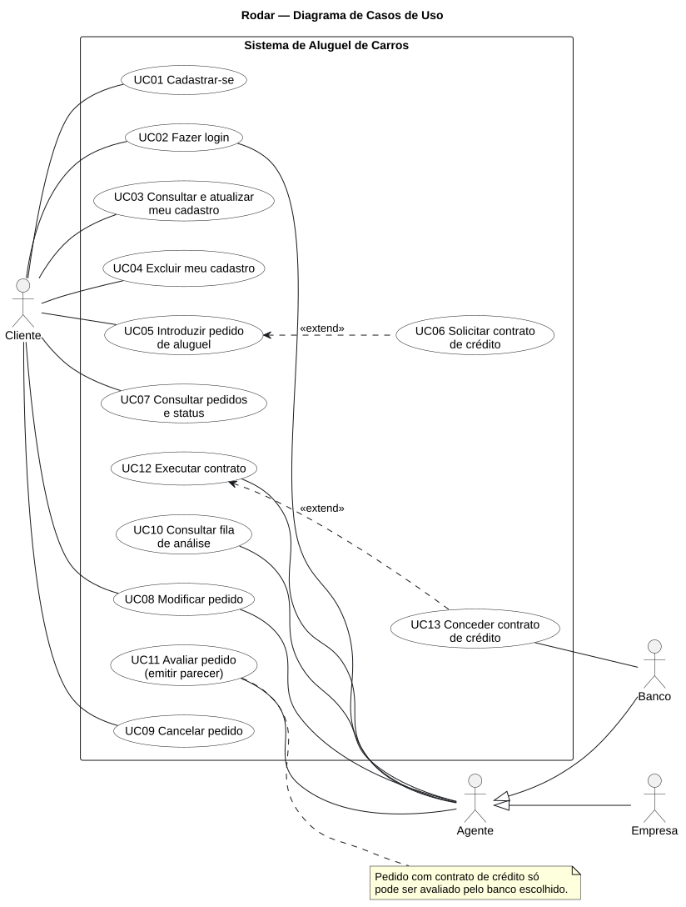
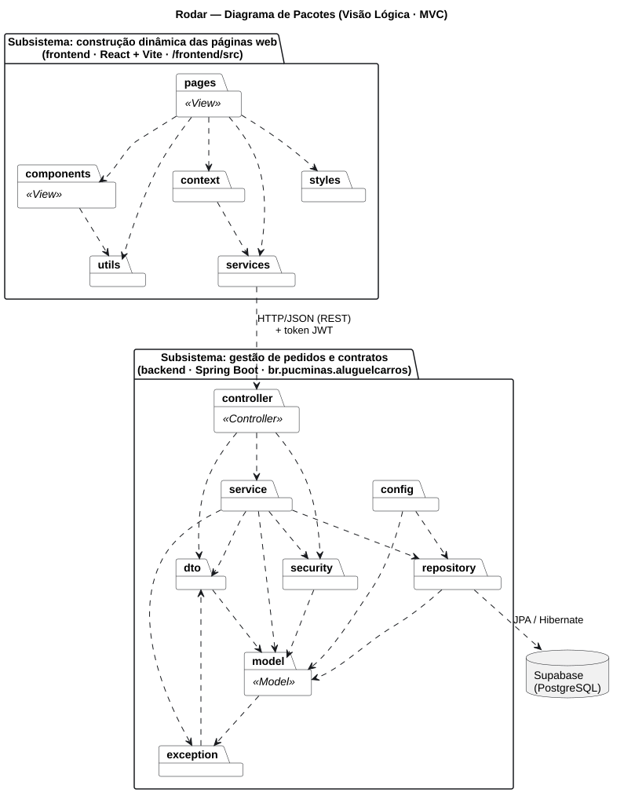
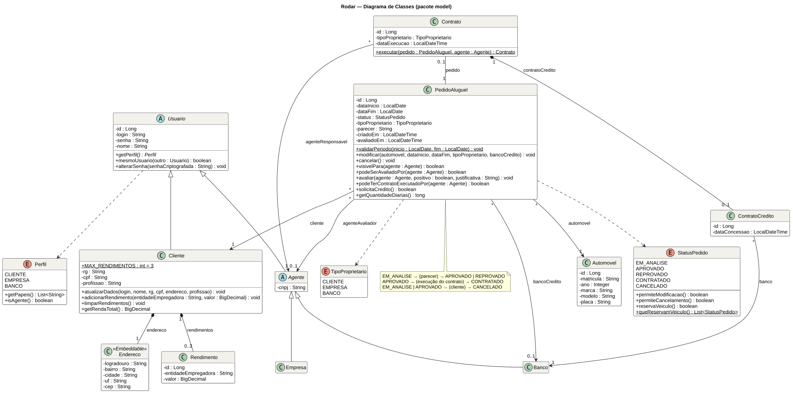
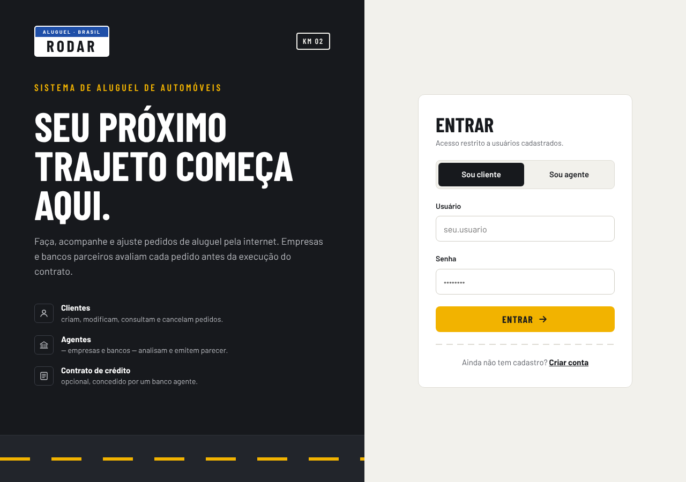
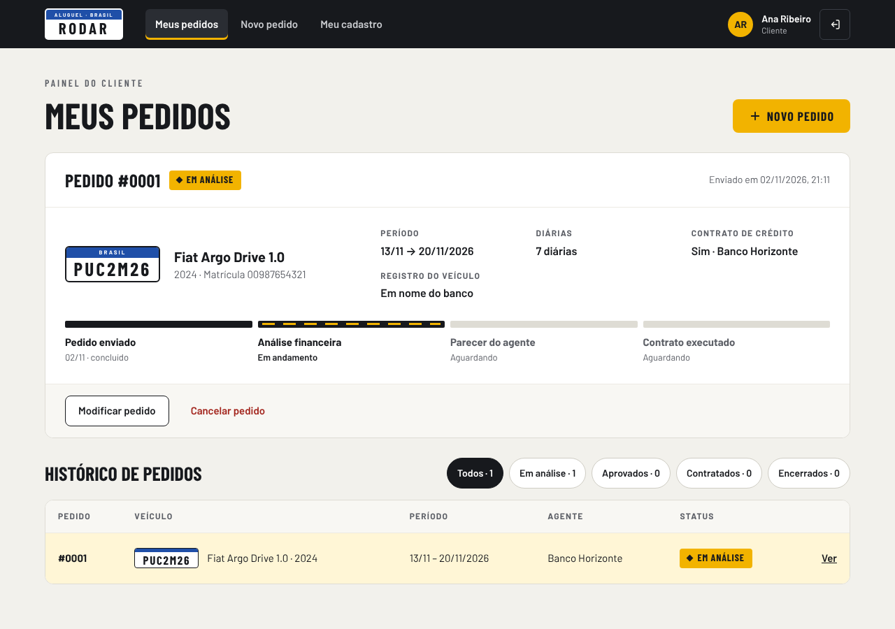
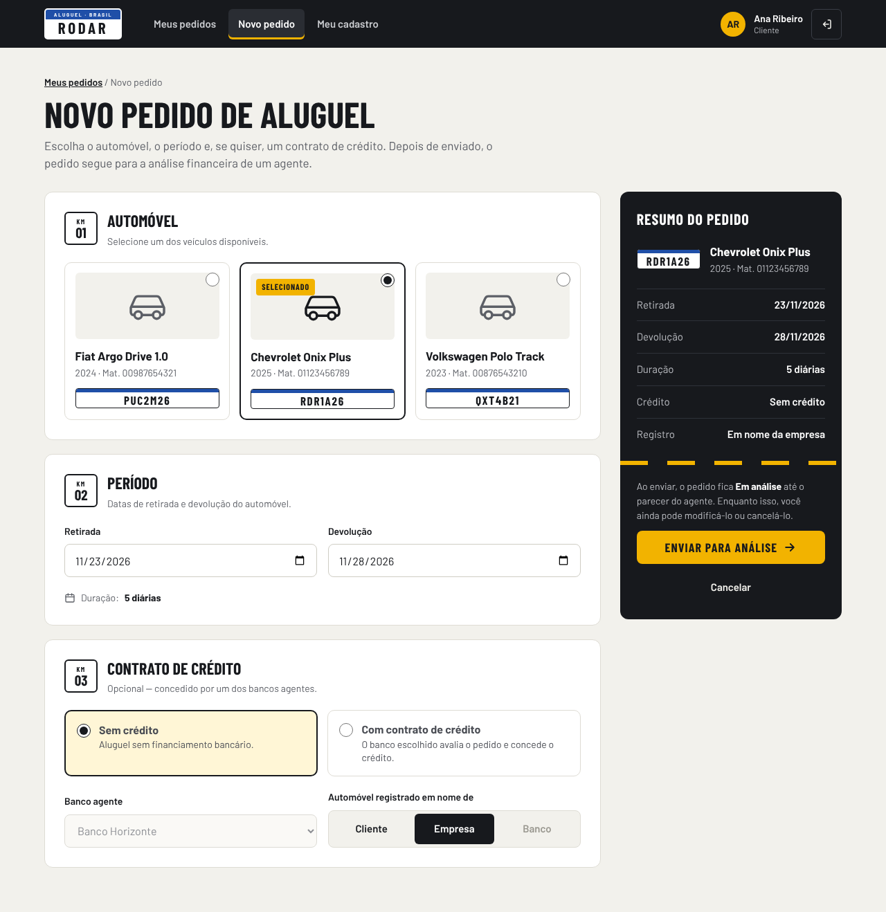
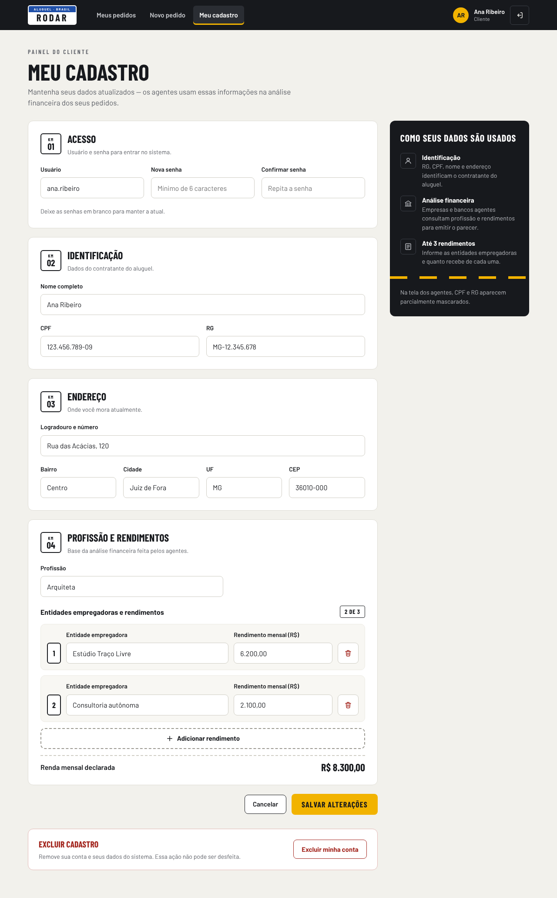
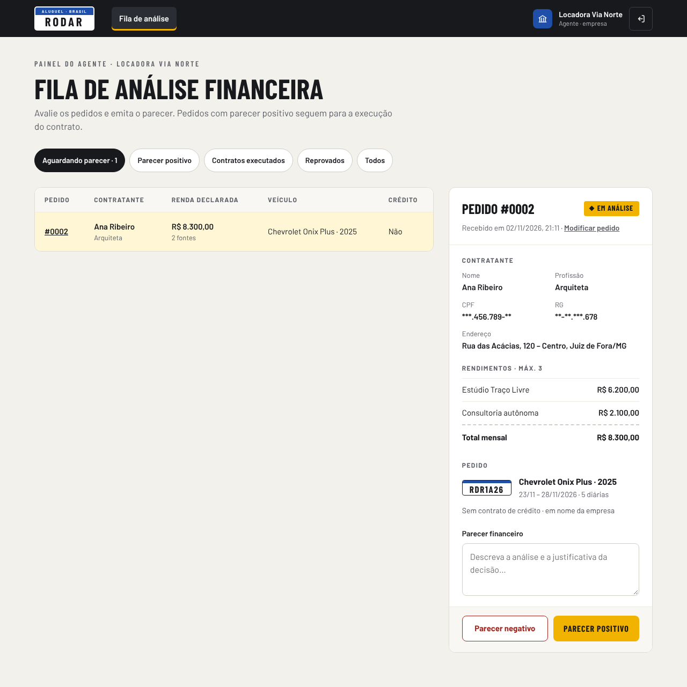
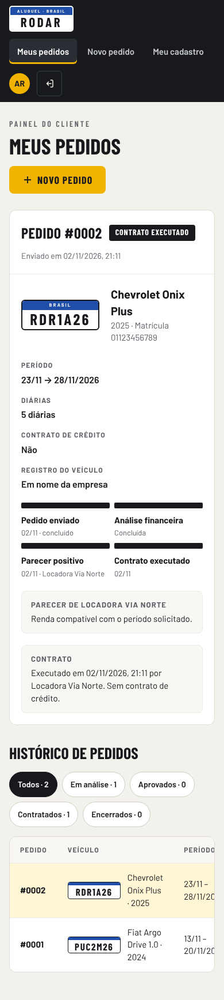

# 🚗 Rodar — Sistema de Aluguel de Carros 👨‍💻

> [!NOTE]
> Sistema web para **efetuar, modificar, consultar e cancelar pedidos de aluguel de automóveis pela internet**, com análise financeira feita por agentes (empresas e bancos) e contrato de crédito opcional.
> Laboratório 02 da disciplina **Desenvolvimento e Integração de Aplicações Web (DIAW)** — Engenharia de Software, PUC Minas.

<table>
  <tr>
    <td width="800px">
      <div align="justify">
        O <b>Rodar</b> apoia a gestão de aluguéis de automóveis. Depois de um <i>cadastro prévio</i> e do <i>login</i>, os <b>clientes</b> introduzem pedidos escolhendo o automóvel, o período e, se quiserem, um <b>contrato de crédito</b> com um banco agente. Os <b>agentes</b> — empresas e bancos — analisam cada pedido do ponto de vista financeiro, emitem um <b>parecer</b> e, quando ele é positivo, <b>executam o contrato</b>. A interface segue a direção visual <i>“Asfalto &amp; Sinalização”</i>: placas Mercosul identificam os carros, a faixa tracejada da estrada mostra o andamento do pedido e os status aparecem como plaquinhas de sinalização.
      </div>
    </td>
    <td>
      <div>
        
      </div>
    </td>
  </tr>
</table>

---

## 🚧 Status do Projeto

      

Protótipo funcional concluído: autenticação, CRUD de cliente, criação e acompanhamento de pedidos, parecer e execução de contrato pelos agentes.

---

## 📚 Índice

- [Links Úteis](#-links-úteis)
- [Sobre o Projeto](#-sobre-o-projeto)
- [Funcionalidades Principais](#-funcionalidades-principais)
- [Tecnologias Utilizadas](#-tecnologias-utilizadas)
- [Arquitetura](#-arquitetura)
  - [Diagramas](#diagramas)
  - [Regras de negócio no modelo](#regras-de-negócio-no-modelo)
- [Instalação e Execução](#-instalação-e-execução)
  - [Pré-requisitos](#pré-requisitos)
  - [Variáveis de Ambiente](#-variáveis-de-ambiente)
  - [Instalação de Dependências](#-instalação-de-dependências)
  - [Inicialização do Banco de Dados (Supabase)](#-inicialização-do-banco-de-dados-supabase)
  - [Como Executar a Aplicação](#-como-executar-a-aplicação)
  - [Contas de demonstração](#-contas-de-demonstração)
- [Deploy](#-deploy)
- [Estrutura de Pastas](#-estrutura-de-pastas)
- [Demonstração](#-demonstração)
- [API REST](#-api-rest)
- [Testes](#-testes)
- [Documentações utilizadas](#-documentações-utilizadas)
- [Autores](#-autores)
- [Contribuição](#-contribuição)
- [Agradecimentos](#-agradecimentos)
- [Licença](#-licença)

---

## 🔗 Links Úteis

- 🌐 **Demo Online:** _ainda não publicada_
  > 💻 Ver a seção [Deploy](#-deploy) para publicar o back-end e o front-end.
- 📖 **Modelagem (UML):** [docs/README.md](docs/README.md)
  > 📚 Casos de uso, histórias do usuário, diagrama de classes e diagrama de pacotes.

---

## 📝 Sobre o Projeto

**Por que existe.** O enunciado do Laboratório 02 pede um sistema de apoio à gestão de aluguéis de automóveis que permita efetuar, cancelar e modificar pedidos pela internet, dando continuidade ao Laboratório 01 (portfólio pessoal).

**Qual problema resolve.** Centraliza o fluxo entre quem aluga e quem aprova: o cliente acompanha em que etapa está o pedido, e os agentes recebem uma fila com os dados financeiros necessários para emitir o parecer — sem trocas de e-mail ou planilhas.

**Contexto.** Acadêmico. O sistema é dividido nos dois subsistemas descritos no enunciado:

1. **Gestão de pedidos e contratos** — API REST em Spring Boot (arquitetura MVC em camadas).
2. **Construção dinâmica das páginas web** — SPA em React + Vite que consome a API.

**Atores.**

- **Cliente (contratante):** guarda RG, CPF, nome, endereço, profissão e até 3 entidades empregadoras com seus rendimentos.
- **Agente:** empresa ou banco aderente. Bancos podem conceder contratos de crédito.

> [!NOTE]
> Os automóveis e os agentes não se cadastram pela interface: são criados automaticamente na primeira execução (ver [Contas de demonstração](#-contas-de-demonstração)).

---

## ✨ Funcionalidades Principais

- 🔐 **Autenticação obrigatória:** login com usuário e senha (senha guardada com BCrypt) e token **JWT**; cada perfil só acessa suas rotas.
- 👤 **CRUD de cliente:** cadastro (criar conta), consulta e atualização (meu cadastro) e exclusão da conta, com limite de **3 rendimentos**.
- 📝 **Pedidos de aluguel:** introduzir, consultar, modificar (enquanto em análise) e cancelar (até a execução do contrato).
- 🚦 **Acompanhamento de status:** andamento visual “enviado → análise → parecer → contrato”, com o parecer e os dados do contrato.
- 🏦 **Contrato de crédito:** o cliente escolhe um banco agente; o pedido passa a ser avaliado apenas por esse banco e, na execução, gera um contrato de crédito.
- 🧾 **Registro do automóvel:** em nome do cliente, da empresa ou do banco (este último só com crédito).
- 🧑‍💼 **Painel do agente:** fila de análise com renda declarada, documentos mascarados, parecer positivo/negativo com justificativa, modificação do pedido e execução do contrato.
- 📅 **Disponibilidade:** o sistema impede dois pedidos ativos para o mesmo automóvel em períodos sobrepostos.
- 📱 **Responsivo:** todas as telas funcionam na largura de um celular.

---

## 🛠 Tecnologias Utilizadas

### 💻 Front-end

- **Framework/Biblioteca:** React 19 + React Router 7
- **Linguagem:** JavaScript (ES2022+, JSX)
- **Estilização:** CSS puro com variáveis (tokens da direção visual), fontes Barlow e Barlow Condensed via Fontsource
- **Gerenciamento de Estado:** Context API (sessão do usuário) + estado local
- **Build Tool:** Vite 8

### 🖥️ Back-end

- **Linguagem/Runtime:** Java 25 (JDK 25)
- **Framework:** Spring Boot 4.0.x (Spring MVC, Spring Data JPA, Bean Validation)
- **Banco de Dados:** Supabase (PostgreSQL); H2 em memória no perfil `dev`
- **ORM:** Hibernate / JPA
- **Autenticação:** Spring Security + OAuth2 Resource Server (JWT assinado com HS256) + BCrypt
- **Build e dependências:** Apache Maven

### ⚙️ Infraestrutura & DevOps

- **Banco gerenciado:** Supabase
- **Cloud (sugestão de deploy):** Render/Railway para a API e Vercel/Netlify para o front-end

---

## 🏗 Arquitetura

O sistema é um **monorepo** com dois subsistemas que se comunicam por **HTTP/JSON**:

```
Navegador ──► React + Vite (páginas)  ──HTTP/JSON + JWT──►  Spring Boot (API REST)  ──JPA──►  Supabase (PostgreSQL)
```

O back-end segue **MVC em camadas**:

| Camada         | Pacote                         | Papel                                                                                           |
| :------------- | :----------------------------- | :---------------------------------------------------------------------------------------------- |
| **Controller** | `controller`                   | Recebe as requisições REST, valida os DTOs e devolve JSON.                                      |
| **Model**      | `model`                        | Entidades JPA com as **regras de negócio** (ex.: `PedidoAluguel.avaliar`, `Contrato.executar`). |
| **View**       | front-end `pages`/`components` | Páginas React que montam a interface dinamicamente a partir da API.                             |
| Service        | `service`                      | Orquestra casos de uso e transações (`@Transactional`).                                         |
| Repository     | `repository`                   | Acesso a dados com Spring Data JPA.                                                             |
| DTO            | `dto`                          | Contratos de entrada e saída da API (records Java).                                             |
| Security       | `security`                     | Configuração do Spring Security e geração do token JWT.                                         |
| Exception      | `exception`                    | Exceções de negócio e tratamento global de erros.                                               |
| Config         | `config`                       | Carga inicial de dados (automóveis, agentes e cliente demo).                                    |

**Padrões adotados:** Repository, Service Layer, DTO, _Rich Domain Model_ (regras nas entidades), Factory Method (`Contrato.executar`), enum com regras (`StatusPedido`).

**Decisões importantes**

- **JWT sem sessão no servidor:** a SPA guarda o token e o envia em `Authorization: Bearer`. Os papéis (`CLIENTE`, `AGENTE`, `BANCO`, `EMPRESA`) vêm do próprio token.
- **Schema próprio no Supabase:** as tabelas ficam no schema `aluguel`, fora do `public` que a API REST automática do Supabase expõe — assim CPF, RG e rendimentos não ficam acessíveis por ela.
- **Herança `JOINED`:** `Usuario` → `Cliente` / `Agente` → `Empresa` / `Banco`, cada um com sua tabela.
- **Perfil `dev` com H2:** permite rodar e apresentar o sistema mesmo sem conexão com o Supabase.

### Diagramas

Fontes PlantUML e imagens em [`docs/diagramas`](docs/diagramas). Detalhes em [docs/README.md](docs/README.md).

|                                  Diagrama de Casos de Uso                                  |                             Diagrama de Pacotes (Visão Lógica)                             |
| :----------------------------------------------------------------------------------------: | :----------------------------------------------------------------------------------------: |
|    |  |
|                              **Diagrama de Classes (model)**                               |                                  **Histórias do Usuário**                                  |
|  |                [docs/historias-de-usuario.md](docs/historias-de-usuario.md)                |

### Regras de negócio no modelo

| Regra                                                                | Onde está                                 |
| :------------------------------------------------------------------- | :---------------------------------------- |
| Cliente tem no máximo 3 rendimentos                                  | `Cliente.adicionarRendimento`             |
| Devolução depois da retirada                                         | `PedidoAluguel.validarPeriodo`            |
| Só pedido em análise pode ser modificado                             | `StatusPedido.permiteModificacao`         |
| Cancelamento até a execução do contrato                              | `StatusPedido.permiteCancelamento`        |
| Registro em nome do banco exige crédito                              | `PedidoAluguel.definirDados`              |
| Pedido com crédito só é avaliado pelo banco escolhido                | `PedidoAluguel.visivelPara` / `avaliar`   |
| Contrato executado pelo agente que aprovou; gera contrato de crédito | `Contrato.executar`                       |
| Automóvel não pode ter dois pedidos ativos no mesmo período          | `PedidoAluguelRepository.contarConflitos` |

---

## 🔧 Instalação e Execução

### Pré-requisitos

- **Java JDK 25** (back-end)
- **Apache Maven 3.9+** (ou o Maven embutido da sua IDE)
- **Node.js 22 LTS** (ou 20.19+) e **npm** (front-end)
- Uma conta gratuita no **[Supabase](https://supabase.com)** (opcional para rodar com o perfil `dev`)

---

### 🔑 Variáveis de Ambiente

#### 1 Back-end (Spring Boot)

Copie `backend/.env.example` para `backend/.env` e preencha. O arquivo é lido automaticamente pelo Spring (`spring.config.import`) e **não deve ser versionado**.

| Variável               | Descrição                                               | Exemplo                                                                               |
| :--------------------- | :------------------------------------------------------ | :------------------------------------------------------------------------------------ |
| `SUPABASE_DB_URL`      | URL JDBC do _Session pooler_ do Supabase.               | `jdbc:postgresql://aws-0-sa-east-1.pooler.supabase.com:5432/postgres?sslmode=require` |
| `SUPABASE_DB_USER`     | Usuário do banco (no pooler: `postgres.<project-ref>`). | `postgres.abcdefghijklmnop`                                                           |
| `SUPABASE_DB_PASSWORD` | Senha definida ao criar o projeto.                      | `sua-senha`                                                                           |
| `JWT_SECRET`           | Chave de assinatura dos tokens (mín. 32 caracteres).    | `uma-frase-longa-e-aleatoria-...`                                                     |
| `DB_SCHEMA`            | Schema das tabelas (opcional).                          | `aluguel`                                                                             |
| `CORS_ORIGENS`         | Origens liberadas no CORS (opcional).                   | `http://localhost:5173`                                                               |
| `SERVER_PORT`          | Porta da API (opcional).                                | `8080`                                                                                |
| `SEED_DEMO`            | Cria a cliente de demonstração (opcional).              | `true`                                                                                |

#### 2 Front-end (React, Vite)

Em desenvolvimento **nenhuma variável é necessária**: o Vite repassa as chamadas `/api` para `http://localhost:8080`.

| Variável       | Descrição                                 | Exemplo                          |
| :------------- | :---------------------------------------- | :------------------------------- |
| `VITE_API_URL` | URL do back-end em produção (sem `/api`). | `https://rodar-api.onrender.com` |

---

### 📦 Instalação de Dependências

1. **Clone o repositório:**

```bash
git clone <URL_DO_REPOSITÓRIO>
cd aluguel-carros
```

2. **Front-end:**

```bash
cd frontend
npm install
cd ..
```

3. **Back-end:**

```bash
cd backend
mvn clean install
cd ..
```

> [!TIP]
> Para usar o Maven Wrapper (`./mvnw`), gere-o uma vez com `mvn wrapper:wrapper` dentro de `backend/` e versione os arquivos criados.

---

### 💾 Inicialização do Banco de Dados (Supabase)

1. Crie um projeto em [supabase.com](https://supabase.com) e anote a senha do banco.
2. No painel do projeto, clique em **Connect** e escolha **Session pooler** (funciona em redes IPv4). Copie host, porta, banco e usuário.
3. Monte a URL JDBC no formato `jdbc:postgresql://HOST:5432/postgres?sslmode=require` e preencha o `backend/.env`.
4. Rode o back-end (próxima seção). Na primeira execução o Hibernate cria o schema `aluguel` e as tabelas (`ddl-auto=update`) e a carga inicial cadastra automóveis, agentes e a cliente de demonstração.
5. Para conferir, abra o **Table Editor** do Supabase e selecione o schema `aluguel`.

> [!NOTE]
> Se o schema não for criado automaticamente, rode no **SQL Editor** do Supabase: `create schema if not exists aluguel;`

---

### ⚡ Como Executar a Aplicação

Use **dois terminais**.

#### Terminal 1: Back-end (Spring Boot)

Com Supabase:

```bash
cd backend
mvn spring-boot:run
```

Sem Supabase (banco H2 em memória, os dados somem ao reiniciar):

```bash
cd backend
mvn spring-boot:run -Dspring-boot.run.profiles=dev
```

🚀 _A API fica em **http://localhost:8080**._

#### Terminal 2: Front-end (React, Vite)

```bash
cd frontend
npm run dev
```

🎨 _O front-end fica em **http://localhost:5173**._

#### 🐳 Docker Compose

Não se aplica: o banco é o Supabase (na nuvem) e o perfil `dev` dispensa banco local.

---

### 👥 Contas de demonstração

Criadas automaticamente na primeira execução:

| Perfil           | Usuário           | Senha        | Observação                                                                  |
| :--------------- | :---------------- | :----------- | :-------------------------------------------------------------------------- |
| Cliente          | `ana.ribeiro`     | `cliente123` | Já tem 3 rendimentos e um pedido em análise com crédito no Banco Horizonte. |
| Agente · banco   | `banco.horizonte` | `agente123`  | Vê o pedido da Ana (crédito escolhido com este banco).                      |
| Agente · banco   | `banco.serra`     | `agente123`  | Vê apenas pedidos sem crédito ou com crédito neste banco.                   |
| Agente · empresa | `via.norte`       | `agente123`  | Vê apenas pedidos sem contrato de crédito.                                  |

> [!WARNING]
> Troque essas senhas (ou desative com `SEED_DEMO=false`) antes de publicar o sistema.

---

## 🚀 Deploy

1. **Build:**

```bash
cd frontend && npm run build        # gera frontend/dist
cd ../backend && mvn clean package   # gera backend/target/aluguel-carros-0.0.1-SNAPSHOT.jar
```

2. **Back-end:** publique o `.jar` (ex.: Render ou Railway) com as variáveis `SUPABASE_DB_URL`, `SUPABASE_DB_USER`, `SUPABASE_DB_PASSWORD`, `JWT_SECRET` e `CORS_ORIGENS` (URL do front-end).

```bash
java -jar backend/target/aluguel-carros-0.0.1-SNAPSHOT.jar
```

3. **Front-end:** publique a pasta `frontend/dist` (ex.: Vercel ou Netlify) com `VITE_API_URL` apontando para a API. Configure o _fallback_ de rotas da SPA para `index.html`.

---

## 📂 Estrutura de Pastas

```
.
├── README.md                     # 📘 Este documento
├── LICENSE                       # ⚖️ Licença MIT
├── .gitignore                    # 🧹 Ignora .env, node_modules, target, dist...
│
├── docs/                         # 📚 Modelagem UML e imagens
│   ├── README.md                 # Índice dos modelos e histórico de versões
│   ├── historias-de-usuario.md   # Histórias do usuário com critérios de aceitação
│   ├── diagramas/                # .puml (fonte) e .svg (imagem) de cada diagrama
│   └── imagens/                  # Logo e capturas de tela
│
├── backend/                      # 📁 Subsistema de gestão de pedidos e contratos
│   ├── .env.example              # 🧩 Variáveis do Supabase e do JWT
│   ├── pom.xml                   # 🛠️ Dependências (Spring Boot 4, Java 25)
│   └── src/
│       ├── main/java/br/pucminas/aluguelcarros/
│       │   ├── controller/       # 🎮 Endpoints REST
│       │   ├── service/          # ⚙️ Casos de uso e transações
│       │   ├── repository/       # 🗄️ Spring Data JPA
│       │   ├── model/            # 🧬 Entidades e regras de negócio
│       │   ├── dto/              # ✉️ Requests e responses da API
│       │   ├── security/         # 🛡️ Spring Security + JWT
│       │   ├── exception/        # 💥 Exceções e handler global
│       │   └── config/           # 🔧 Carga inicial de dados
│       ├── main/resources/
│       │   ├── application.properties      # ⚙️ Supabase (padrão)
│       │   └── application-dev.properties  # 🧪 H2 em memória
│       └── test/java/            # 🧪 Testes unitários do domínio
│
└── frontend/                     # 📁 Subsistema de construção das páginas web
    ├── .env.example
    ├── index.html
    ├── vite.config.js            # Proxy /api → localhost:8080
    ├── package.json
    └── src/
        ├── pages/                # 📄 Login, Criar conta, Meus pedidos, Novo pedido, Meu cadastro, Painel do agente
        ├── components/           # 🧱 Navbar, Placa, StatusChip, Trajeto, KmSecao, FormCliente...
        ├── context/              # 🔐 Sessão do usuário (AuthContext)
        ├── services/             # 🔌 Cliente HTTP e endpoints
        ├── utils/                # 🛠️ Formatação de datas e valores
        └── styles/               # 🎨 Tokens e estilos globais
```

---

## 🎥 Demonstração

### 🌐 Aplicação Web

|                                          Tela                                          |                                 Captura de Tela                                  |
| :------------------------------------------------------------------------------------: | :------------------------------------------------------------------------------: |
|                                       **Login**                                        |                            **Meus pedidos (cliente)**                            |
|                    |        |
|                                    **Novo pedido**                                     |                        **Meu cadastro (CRUD de cliente)**                        |
|                |        |
|                              **Fila de análise (agente)**                              |                                   **Celular**                                    |
|  |  |

### 💻 Exemplo de Saída no Terminal (API)

**Login:**

```bash
curl -X POST http://localhost:8080/api/auth/login \
     -H 'Content-Type: application/json' \
     -d '{"login": "ana.ribeiro", "senha": "cliente123"}'
```

```json
{
  "token": "eyJhbGciOiJIUzI1NiJ9...",
  "usuario": {
    "id": 4,
    "nome": "Ana Ribeiro",
    "login": "ana.ribeiro",
    "perfil": "CLIENTE"
  }
}
```

**Novo pedido:**

```bash
curl -X POST http://localhost:8080/api/pedidos \
     -H 'Authorization: Bearer <token>' \
     -H 'Content-Type: application/json' \
     -d '{"automovelId": 2, "dataInicio": "2026-12-10", "dataFim": "2026-12-15", "tipoProprietario": "CLIENTE", "bancoCreditoId": null}'
```

**Erro de regra de negócio (400):**

```json
{
  "status": 400,
  "mensagem": "Este automóvel já está reservado nesse período. Escolha outras datas ou outro veículo.",
  "campos": {},
  "timestamp": "2026-11-02T21:30:00"
}
```

---

## 🔌 API REST

Todas as rotas, exceto as de `/api/auth`, exigem o cabeçalho `Authorization: Bearer <token>`.

| Método   | Rota                                | Perfil      | Descrição                                                    |
| :------- | :---------------------------------- | :---------- | :----------------------------------------------------------- |
| `POST`   | `/api/auth/login`                   | público     | Login; devolve o token JWT                                   |
| `POST`   | `/api/auth/registrar`               | público     | Cadastra cliente e devolve o token                           |
| `GET`    | `/api/clientes/me`                  | cliente     | Consulta o próprio cadastro                                  |
| `PUT`    | `/api/clientes/me`                  | cliente     | Atualiza o próprio cadastro                                  |
| `DELETE` | `/api/clientes/me`                  | cliente     | Exclui o próprio cadastro                                    |
| `GET`    | `/api/pedidos`                      | cliente     | Lista os pedidos do cliente                                  |
| `GET`    | `/api/pedidos/{id}`                 | cliente     | Consulta um pedido                                           |
| `POST`   | `/api/pedidos`                      | cliente     | Introduz um pedido                                           |
| `PUT`    | `/api/pedidos/{id}`                 | cliente     | Modifica um pedido em análise                                |
| `PATCH`  | `/api/pedidos/{id}/cancelar`        | cliente     | Cancela um pedido                                            |
| `GET`    | `/api/agente/pedidos?status=`       | agente      | Fila de pedidos visíveis ao agente                           |
| `GET`    | `/api/agente/pedidos/{id}`          | agente      | Pedido com dados do contratante                              |
| `PUT`    | `/api/agente/pedidos/{id}`          | agente      | Modifica um pedido em análise                                |
| `POST`   | `/api/agente/pedidos/{id}/parecer`  | agente      | Emite parecer `{ "positivo": true, "justificativa": "..." }` |
| `POST`   | `/api/agente/pedidos/{id}/contrato` | agente      | Executa o contrato                                           |
| `GET`    | `/api/automoveis`                   | autenticado | Lista os automóveis                                          |
| `GET`    | `/api/bancos`                       | autenticado | Lista os bancos agentes                                      |

---

## 🧪 Testes

### Testes unitários (back-end)

Cobrem as regras de negócio do pacote `model` (limite de rendimentos, ciclo de status, visibilidade por banco, execução do contrato e contrato de crédito) e o mascaramento de documentos.

```bash
cd backend
mvn test
```

_Ferramenta: JUnit 5 (via `spring-boot-starter-test`)._

### Build do front-end

```bash
cd frontend
npm run build
```

---

## 🔗 Documentações utilizadas

- 📖 [Documentação do **Spring Boot**](https://docs.spring.io/spring-boot/index.html)
- 📖 [Guia de migração do **Spring Boot 4.0**](https://github.com/spring-projects/spring-boot/wiki/Spring-Boot-4.0-Migration-Guide)
- 📖 [**Spring Security** — OAuth2 Resource Server / JWT](https://docs.spring.io/spring-security/reference/servlet/oauth2/resource-server/jwt.html)
- 📖 [**Supabase** — conexão com o banco](https://supabase.com/docs/guides/database/connecting-to-postgres)
- 📖 [Documentação do **React**](https://react.dev/reference/react)
- 📖 [Configuração do **Vite**](https://vite.dev/config/)
- 📖 [**PlantUML**](https://plantuml.com/)
- 📖 [Repositório da disciplina — DIAW](https://github.com/joaopauloaramuni/desenvolvimento-e-integracao-de-aplicacoes-web)

---

## 👥 Autores

| 👤 Nome             | 🖼️ Foto                                                                                                | :octocat: GitHub                                                                                                                                                      | 💼 LinkedIn                                                                                                                                                                       | 📤 Gmail                                                                                                                                                      |
| ------------------- | ------------------------------------------------------------------------------------------------------ | --------------------------------------------------------------------------------------------------------------------------------------------------------------------- | --------------------------------------------------------------------------------------------------------------------------------------------------------------------------------- | ------------------------------------------------------------------------------------------------------------------------------------------------------------- |
| Bruna Pedrosa Nunes | <div align="center"></div> | <div align="center"><a href="https://github.com/brunapedrosabr"></a></div> | <div align="center"><a href="https://www.linkedin.com/in/brunapedrosabr/"></a></div> | <div align="center"><a href="mailto:buupnunes@gmail.com"></a></div> |

---

## 🤝 Contribuição

1. Faça um `fork` do projeto.
2. Crie uma branch para sua feature (`git checkout -b feature/minha-feature`).
3. Faça commit das mudanças (`git commit -m 'feat: adiciona nova funcionalidade X'`), seguindo [Conventional Commits](https://www.conventionalcommits.org/pt-br/v1.0.0/).
4. Faça `push` para a branch (`git push origin feature/minha-feature`).
5. Abra um **Pull Request**.

> [!IMPORTANT]
> Ao mudar uma regra de negócio, atualize também o diagrama correspondente em `docs/diagramas` e registre a versão em `docs/README.md`.

---

## 🙏 Agradecimentos

- [**Engenharia de Software PUC Minas**](https://www.instagram.com/engsoftwarepucminas/) — pelo apoio institucional e pela estrutura acadêmica.
- [**Prof. Dr. João Paulo Aramuni**](https://github.com/joaopauloaramuni) — pelos ensinamentos em Desenvolvimento e Integração de Aplicações Web e pelo template deste README.

---

## 📄 Licença

Este projeto é distribuído sob a **[Licença MIT](LICENSE)**.

---
