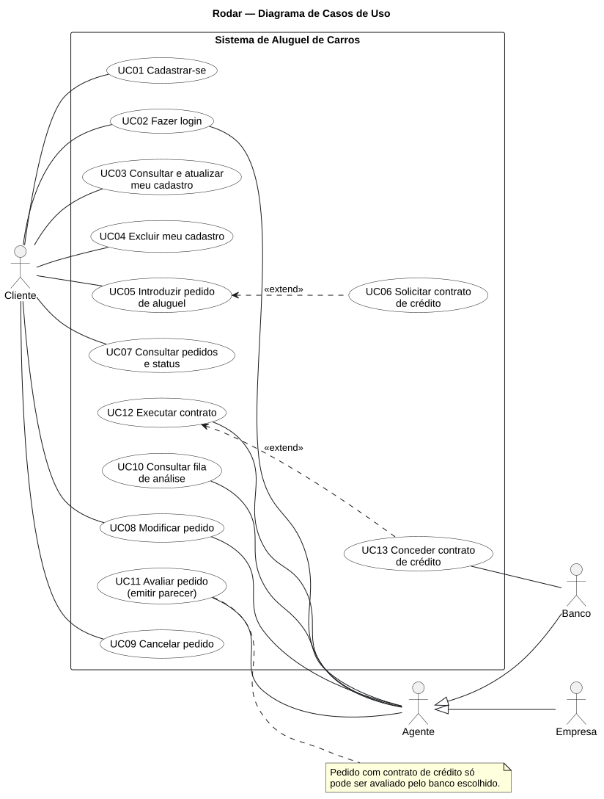
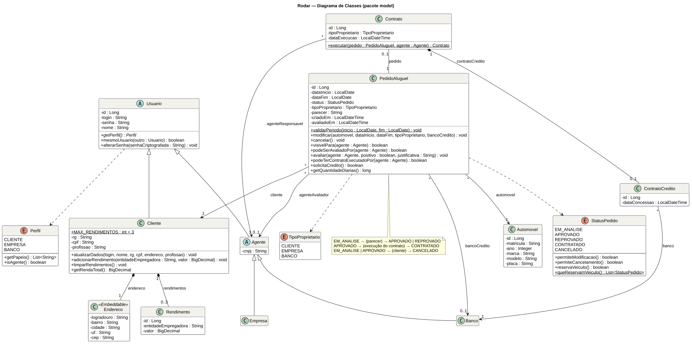
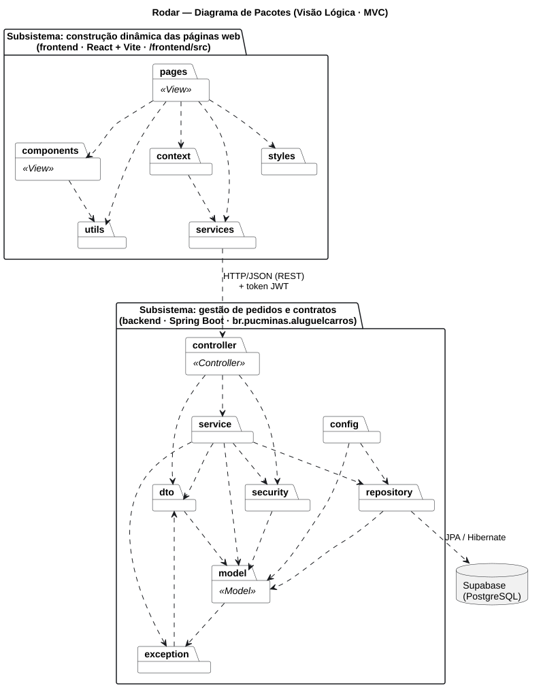

# Modelagem — Rodar

Modelos UML do Laboratório 02 (DIAW). As fontes estão em PlantUML (`.puml`) e as imagens (`.svg`) foram geradas a partir delas. Ao alterar o código, atualize o `.puml` correspondente e gere o `.svg` de novo (por exemplo, no [PlantUML Web Server](https://www.plantuml.com/plantuml) ou na extensão PlantUML do VS Code).

| Modelo | Fonte | Imagem |
| :--- | :--- | :--- |
| Diagrama de Casos de Uso | [casos-de-uso.puml](diagramas/casos-de-uso.puml) | [casos-de-uso.svg](diagramas/casos-de-uso.svg) |
| Histórias do Usuário | [historias-de-usuario.md](historias-de-usuario.md) | — |
| Diagrama de Classes | [diagrama-de-classes.puml](diagramas/diagrama-de-classes.puml) | [diagrama-de-classes.svg](diagramas/diagrama-de-classes.svg) |
| Diagrama de Pacotes (Visão Lógica) | [diagrama-de-pacotes.puml](diagramas/diagrama-de-pacotes.puml) | [diagrama-de-pacotes.svg](diagramas/diagrama-de-pacotes.svg) |

## Diagrama de Casos de Uso

## Diagrama de Classes

Corresponde ao pacote `br.pucminas.aluguelcarros.model` do back-end: cada classe, atributo e método do diagrama existe no código com o mesmo nome.

## Diagrama de Pacotes

Os dois subsistemas pedidos no enunciado: **construção dinâmica das páginas web** (front-end React) e **gestão de pedidos e contratos** (back-end Spring Boot em camadas MVC).

## Histórico de versões dos modelos

| Versão | Data | Alteração |
| :--- | :--- | :--- |
| 1.0 | 02/11/2026 | Primeira versão dos quatro modelos, alinhada ao protótipo. |
